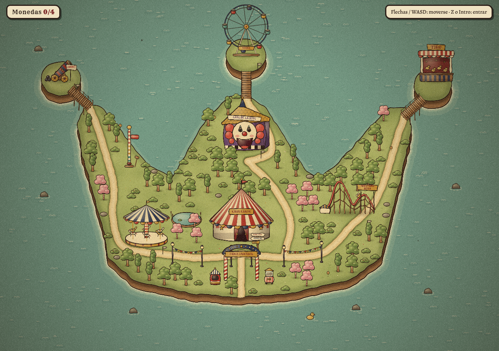

# Page_for_my_selft

## PixelLab (generación de assets de pixel art)

El servidor MCP de PixelLab está configurado en `.mcp.json` y lee la key de la
variable de entorno `PIXELLAB_API_KEY`. La key nunca se guarda en el repo.

- Claude Code web: Ajustes del entorno > Variables/Secretos > `PIXELLAB_API_KEY`.
- Local: `export PIXELLAB_API_KEY=pixl_...` y abre Claude Code en esta carpeta.

## Assets

### Joker Morado (`assets/joker-morado/`)
Sprite 64x64 generado con PixelLab a partir del concept art. Animaciones mirando a la derecha (`east`); las hojas `*_west_sheet.png` son el volteo horizontal.

| Animación | Fotogramas | Hoja de sprites |
|---|---|---|
| Idle | 4 | `idle_east_sheet.png` |
| Caminar | 8 | `walk_east_sheet.png` |
| Lanzar rayo | 6 | `cast_east_sheet.png` |

`frames/` tiene los PNG sueltos, `rotations/` las 8 direcciones estáticas y `*_preview.gif` una vista previa.

## The Circus (`mapa-feria/index.html`)

Juego jugable en el navegador, en un solo archivo y sin dependencias. Incluye la introducción
con la historia y el primer mundo (Isla Cascabel).

**Recorrido de la introducción**
1. Pantalla de título (con opción de saltar la historia).
2. Viñetas: la función del circo y el jefe llamando a los hermanos a su oficina.
3. Escena jugable dentro de la carpa, sobre la ilustración del autor (`assets/carpa/`): pista central,
   zona de entrenamiento, jaula del tigre y la oficina del jefe. Las luces parpadean, los focos barren la
   pista, el aro arde y los artistas hacen cosas. Se puede hablar con ellos. Al hablar con el jefe se pasa a las viñetas del despido.
4. Viñetas: el despido, los hermanos en casa sin nada que comer y el anuncio de la pizzería.
5. Contrato en pergamino que se firma con un garabato (ratón, dedo o tecla Z).
6. Viñetas del primer reparto y la aparición de los monstruos.
7. Minijuego de pizzas en moto: cambiar de carril y lanzar pizzas a los monstruos.
8. Viñetas: despido de la pizzería, pilotos de avión, camareros y salida a buscarse la vida.
9. Llegada al mapa de la Isla Cascabel.

Los hermanos, el jefe del circo, el comerciante y el pizzero usan recortes de las ilustraciones de
referencia (`assets/hermanos/`, `assets/jefe/`, `assets/comerciante/`, `assets/pizzero/`). Los nombres
de los personajes secundarios son provisionales.

### Mapa de mundo: Isla Cascabel

Mapa de mundo jugable con temática de feria y payasos, inspirado en cómo funciona el
mapa de Cuphead. Abre `mapa-feria/index.html` en el navegador; no necesita servidor ni dependencias.

**Cómo está hecho (las mismas técnicas que el mapa de Cuphead):**
- **Cámara:** vista cenital oblicua 3/4 que sigue al jugador con suavizado y algo de
  anticipación según hacia dónde camina, con zoom fijo y límites en los bordes del mundo.
- **Profundidad:** cada objeto se ordena por su coordenada Y, así el jugador pasa por
  delante o por detrás de árboles y edificios.
- **Isla con volumen:** acantilado visible en las costas del sur, espuma animada y aguas someras.
- **Estilo cartoon de los años 30:** formas blandas y abombadas, volumen pintado (brillo arriba a la
  izquierda y sombra abajo a la derecha), línea de tinta más gruesa en el lado de la sombra, copas de
  árbol con un único contorno exterior, suelo de acuarela, trazo que tiembla a 12 fps (3 variantes por
  sprite), tinte sepia, viñeta, grano de película, polvo y rayas.
- **Niveles:** cada atracción tiene una bandera (gris pendiente, roja visitada), un botón
  "Z" flotante y una tarjeta de título. Al entrar se cierra un iris sobre el jugador.

**Forma de la isla:** gorro de bufón de tres puntas; en cada punta cuelga un "cascabel"
(islote) unido por un puente: Cañón humano, Noria y Caseta de tiro.

| Nivel | Atracción |
|---|---|
| 1 | Carrusel Desbocado |
| 2 | La Casa de la Risa |
| 3 | Montaña Rusa Infernal |
| 4 | El Gran Cañón Humano |
| 5 | La Noria Lunar |
| Jefe | ¡La Gran Función! (Gran Carpa) |

Viajes: el globo de la costa suroeste abre el selector de mundos (Isla Cascabel, Valle Encantado,
Pantano Lúgubre y Ciudadela Infernal; los tres últimos aún cerrados).
Cada mundo lleva su propio texto de requisito (`req` en `WORLDS`), porque la forma de desbloquear el
viaje cambia según la zona.

Extras: 4 monedas escondidas, martillo de fuerza, taquilla, poste indicador y caseta de tiro: entra en la escena de la tienda, con el comerciante tras el mostrador y 3 armas y 3 objetos marcados como «Próximamente».

Historia, armas y mundos del juego: [`docs/historia-y-armas.md`](docs/historia-y-armas.md).
Controles: flechas/WASD para moverse; Z, Intro o Espacio para interactuar; X o Esc para volver;
joystick táctil en móvil.

En el mapa los hermanos caminan juntos: el bufón va delante y el punk le sigue.
